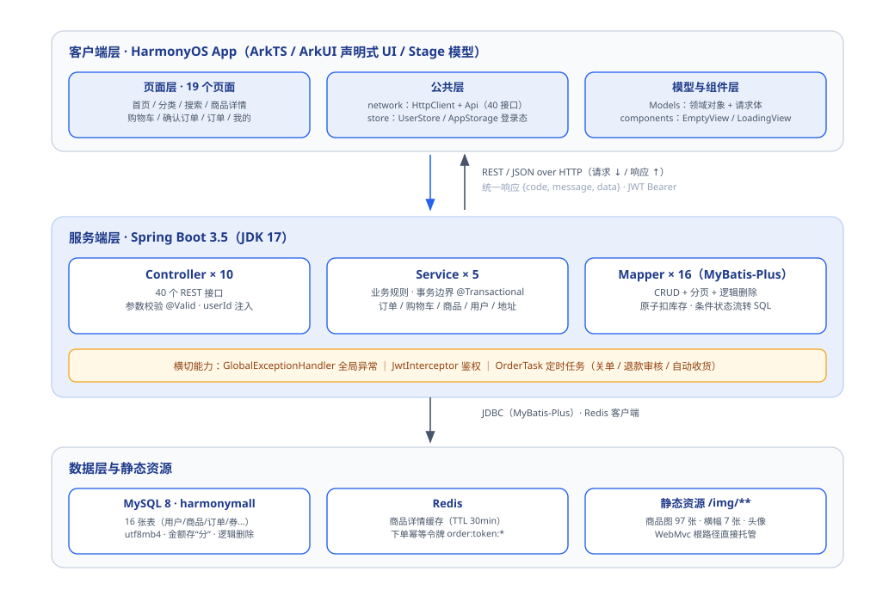
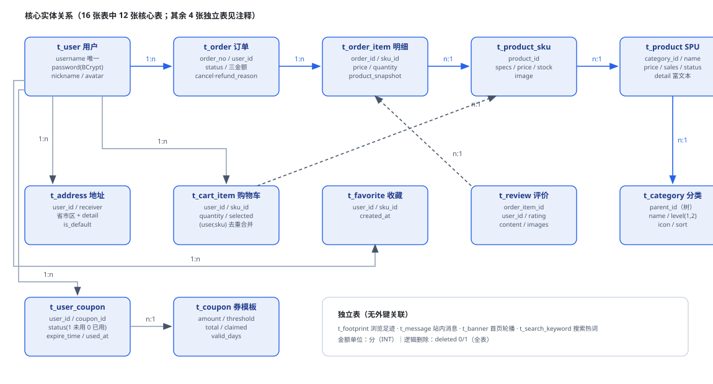
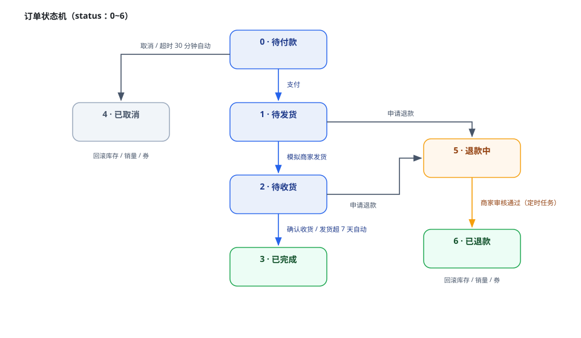
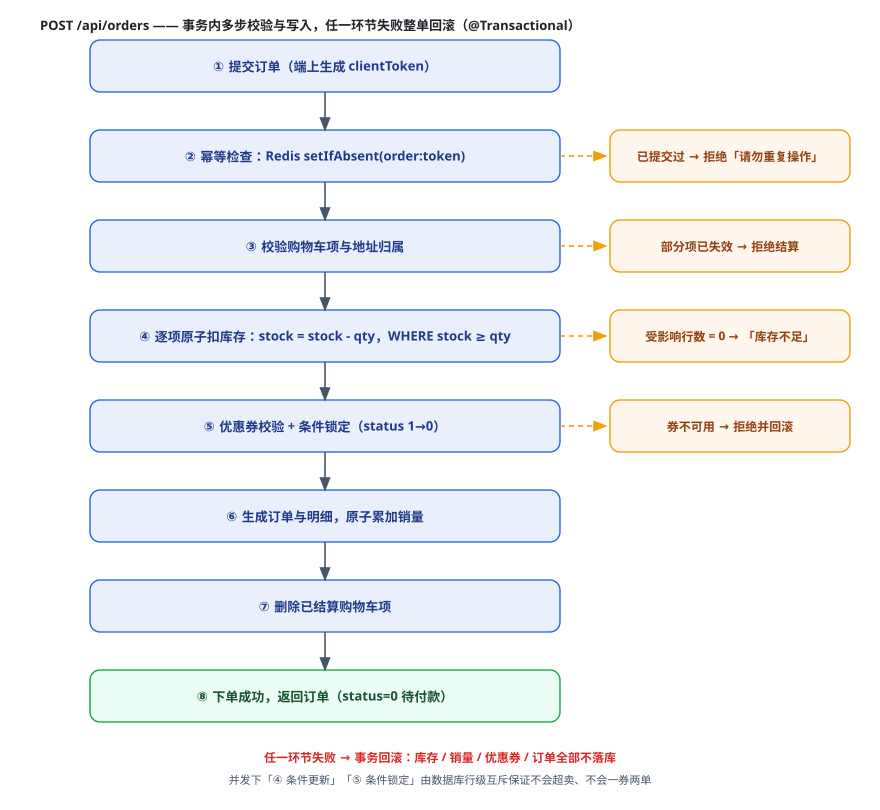
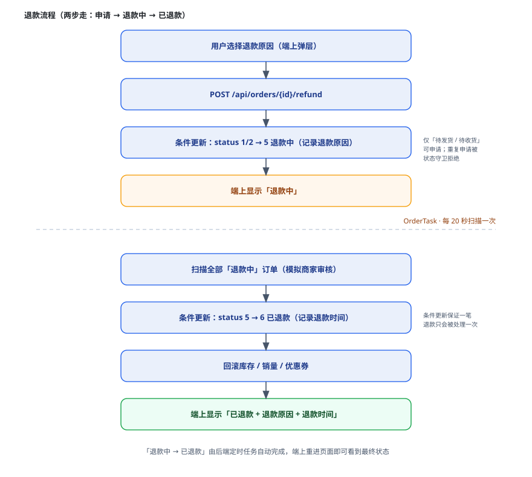

# 鸿蒙商城毕业设计 · 系统设计文档

> 版本：V1.0｜日期：2026-10-16｜配套文档：《需求分析报告》V1.0（2026-10-14）
> 说明：本文档对应**已实现并通过端到端联调**的系统——客户端 19 个页面、服务端 10 个 Controller / 40 个接口、MySQL 16 张表。

---

## 1. 引言

### 1.1 编写目的

本文档在《需求分析报告》的基础上，给出鸿蒙商城系统的**详细设计**：总体架构、客户端与服务端分层设计、数据库结构（ER 图 + 表结构）、接口设计、核心业务流程（订单状态机、下单、退款）以及关键技术方案。用于指导编码实现，并作为毕业论文"系统设计"章节的核心素材。

### 1.2 设计范围与依据

| 项 | 说明 |
|---|---|
| 设计范围 | HarmonyOS 客户端（ArkTS/ArkUI）+ Spring Boot 服务端 + MySQL/Redis 数据层 |
| 设计依据 | 《需求分析报告》V1.0；华为官方《购物商城应用案例》架构实践 |
| 技术基线 | DevEco Studio 6.1.1（SDK 6.1.1/API 24）；Spring Boot 3.5 + JDK 17 |
| 对应实现 | 客户端工程 `HarmonyMall`；服务端工程 `harmonymall-server` |

### 1.3 术语与约定

| 术语 | 说明 |
|---|---|
| SPU / SKU | 商品与商品规格；一个 SPU 对应多个 SKU（如"颜色-尺码"组合） |
| 快照（snapshot） | 下单时把商品与地址的关键信息序列化为 JSON 存入订单，后续商品改价/改地址不影响历史订单 |
| 逻辑删除 | 行不物理删除，`deleted` 字段 0/1 标记，由 MyBatis-Plus 全局过滤 |
| 金额单位 | 一律为**分**（INT 存储），避免浮点误差 |
| 状态码 | 业务状态用 TINYINT 数值表示（如订单 0~6），口径见 7.3 |

---

## 2. 系统总体设计

### 2.1 设计目标与原则

| 原则 | 落地方式 |
|---|---|
| 前后端分离 | 客户端只通过 REST/JSON 与服务端交互，服务端不渲染任何页面 |
| 分层清晰 | 客户端"页面 → 公共层 → 模型"；服务端"Controller → Service → Mapper" |
| 统一约定 | 统一响应体、统一错误码、统一分页结构、统一鉴权方式 |
| 数据一致性优先 | 订单链路全部放在数据库事务内；并发场景用 SQL 条件更新保证原子性 |
| 演示可闭环 | 支付、发货、退款等需要第三方的环节以"模拟实现"打通全链路（毕设范围） |

### 2.2 总体架构



*图 2-1　系统总体架构图*

架构说明：

- **客户端层**：HarmonyOS App（Stage 模型）。页面层 19 个页面；公共层含网络封装（HttpClient/Api）、登录态（AppStorage/UserStore）、格式化工具（FormatUtil）；模型层定义领域对象。
- **接口层**：REST/JSON over HTTP，统一响应体 `{code, message, data}`；JWT 通过 `Authorization: Bearer` 头传递。
- **服务端层**：Spring Boot 单体分层——Controller（参数校验/鉴权注入）→ Service（业务事务）→ Mapper（MyBatis-Plus）；横切能力有全局异常处理、JWT 拦截器、定时任务。
- **数据层**：MySQL 8 持久化 16 张表；Redis 承担商品详情缓存、下单幂等令牌；商品图片作为静态资源（`/img/**`）由服务端直接托管。

### 2.3 技术选型（实际使用版本）

| 端 | 领域 | 选型 |
|---|---|---|
| 客户端 | 系统/语言 | HarmonyOS NEXT（SDK 6.1.1 / API 24）+ ArkTS（strict） |
| 客户端 | UI / 模型 | ArkUI 声明式开发范式 + Stage 应用模型（UIAbility） |
| 客户端 | 路由 / 状态 | `@ohos.router`；V1 状态管理（@State/@StorageProp/@Watch）+ AppStorage 全局登录态 |
| 客户端 | 网络 | `@ohos.net.http` 自封装（Promise 化、token 注入、40100 自动跳登录） |
| 服务端 | 框架 | Spring Boot 3.5.4（JDK 17） |
| 服务端 | 安全 | Spring Security + JWT（jjwt 0.12.6，有效期 24h）+ BCrypt |
| 服务端 | 持久层 | MyBatis-Plus 3.5.7（分页插件、逻辑删除、条件更新） |
| 服务端 | 存储 | MySQL 8.0（utf8mb4）+ Redis（缓存/幂等令牌） |
| 服务端 | 文档 | springdoc-openapi（Swagger UI） |
| 服务端 | 调度 | Spring Scheduling（订单超时关单/退款审核/自动收货） |

### 2.4 部署与联调拓扑

| 环节 | 说明 |
|---|---|
| 开发部署 | 服务端在本机 8080 启动；MySQL 3306 / Redis 6379 本机运行 |
| 模拟器联调 | 模拟器为 QEMU NAT 网络，经 `hdc rport tcp:8080 tcp:8080` 端口转发访问主机后端，客户端 `BASE_URL = http://127.0.0.1:8080/api` |
| 真机联调 | 与电脑同一局域网，`BASE_URL` 换成主机局域网 IP |
| 明文 HTTP | HarmonyOS NEXT 默认禁明文，通过 `network_config.json`（`cleartextTrafficPermitted: true`）显式放行 |

---

## 3. 客户端设计

### 3.1 页面结构与导航关系

客户端共 19 个页面，其中 `IndexPage` 为底部 Tab 容器（首页/分类/购物车/我的），其余为路由页面：

| 分类 | 页面 | 职责 |
|---|---|---|
| 容器 | IndexPage | 自定义 Tab 容器，承载四个主 Tab |
| 首页 | HomePage | 轮播、金刚区分类、推荐商品网格 |
| 商品 | CategoryPage / SearchPage / DetailPage | 分类浏览（二级分组预览）、搜索（历史+热词）、详情（SKU/库存/收藏/评价） |
| 交易 | CartPage / OrderConfirmPage | 购物车（勾选/数量/售罄）、确认订单（地址+优惠券+幂等提交） |
| 订单 | OrderListPage / OrderDetailPage | 列表（状态 Tab/快捷操作）、详情（倒计时/支付/取消/退款/评价） |
| 账户 | LoginPage / RegisterPage / MePage / ProfileEditPage | 登录注册、个人中心、资料编辑 |
| 资产 | FavoritePage / FootprintPage / CouponPage / MessagePage | 收藏、足迹、优惠券、消息 |
| 地址 | AddressListPage / AddressEditPage | 地址管理（选择模式/默认/增删改） |

导航约定：详情类页面（DetailPage / OrderDetailPage 等）无系统标题栏，页内固定「← 返回」栏且**置于加载态之外**；二级页返回主列表后依赖 `onPageShow()` 或 `@Watch` 刷新。

### 3.2 工程分层与公共模块

```
entry/src/main/ets/
├── entryability/EntryAbility.ets     # 应用入口
├── common/
│   ├── AppConfig.ets                 # BASE_URL / IMG_BASE / PAGE_SIZE
│   ├── network/HttpClient.ets        # @ohos.net.http 封装（token/错误码/泛型）
│   ├── network/Api.ets               # 全部 40 个接口的客户端定义
│   ├── store/UserStore.ets           # AppStorage 登录态读写
│   └── utils/FormatUtil.ets          # 分→元、时间、订单状态、快照解析
├── model/Models.ets                  # 领域模型 + 请求对象（20+）
├── components/                       # EmptyView / LoadingView 等公共组件
└── pages/                            # 19 个页面
```

### 3.3 状态管理设计

| 设计点 | 做法 |
|---|---|
| 登录态全局共享 | token/用户信息存 `AppStorage`（**必须用 `setOrCreate`**，`set` 在 key 不存在时不生效）；子页面用 `@StorageProp('token') @Watch(...)` 感知登录态变化并在 `router.back()` 后自动刷新 |
| 列表数据刷新 | `@State` 只观测第一层——修改数组元素内部属性不触发渲染，**统一"整体替换数组"**（如购物车 `replaceItem()`） |
| 跨页数据传递 | `router.pushUrl({ url, params })` 传参，`getParams()` 读取（如订单 id、分类 id） |
| 定时刷新 | 订单列表 `onPageShow()` 重新拉取；待付款倒计时用 `setInterval` + `aboutToDisappear` 清理 |

### 3.4 网络层设计

- `HttpClient` 统一封装 `@ohos.net.http`：泛型解析、请求/响应日志、`Authorization` 自动注入；
- 服务端 `code = 40100`（未登录/token 过期）时自动清登录态并跳转 `LoginPage`；
- 图片地址由 `AppConfig.imgUrl()` 把相对路径（如 `/img/products/x.jpg`）补全为绝对地址；
- 商品详情的富文本用 Web 组件渲染。

---

## 4. 服务端设计

### 4.1 分层结构

```
src/main/java/com/harmonymall/
├── HarmonyMallApplication.java       # 启动类（@EnableScheduling）
├── common/                           # Result 统一响应 / ResultCode / BizException / 全局异常 / 分页
├── config/                           # MyBatis-Plus 分页、WebMvc 拦截器注册 + CORS
├── security/                         # JwtUtil / JwtInterceptor / SecurityConfig
├── entity/                           # 16 个实体（字段与表一一对应）
├── mapper/                           # 16 个 Mapper（含原子扣库存、条件状态流转 SQL）
├── dto/                              # 请求/响应对象（Create/Update/VO 系列）
├── service/                          # User / Address / Product(含缓存) / Cart / Order(事务) —— 5 个领域服务
├── task/OrderTask.java               # 定时任务：关单 / 退款审核 / 自动收货
└── controller/                       # 10 个 Controller，共 40 个接口
```

分层职责与约束：

| 层 | 职责 | 约束 |
|---|---|---|
| Controller | 路由、参数校验（`@Valid`）、取 `@RequestAttribute("userId")` | 不写业务逻辑 |
| Service | 业务规则、事务边界（`@Transactional`）、状态机校验 | 跨表操作全部在事务内 |
| Mapper | 单表 CRUD（MyBatis-Plus）+ 少数手写原子 SQL | 并发关键路径用条件更新 |

### 4.2 统一响应与全局异常

统一响应体：

```json
{ "code": 0, "message": "ok", "data": { } }
```

| code | 含义 | 处理位置 |
|---|---|---|
| 0 | 成功 | Result.ok() |
| 20000 | 参数错误（参数校验失败） | 全局异常处理 |
| 40100 | 未登录 / token 失效 | JwtInterceptor；客户端自动跳登录 |
| 40400 | 接口不存在 | 全局异常处理 |
| 40500 | 请求方法不支持 | 全局异常处理 |
| 50000 | 业务/系统异常 | `BizException` 与兜底 Exception |

业务错误统一抛 `BizException(message)`，由 `GlobalExceptionHandler` 转成 `code=50000` 的响应（如「库存不足」「仅待付款订单可取消」）。

### 4.3 安全设计（JWT + 鉴权）

| 设计点 | 做法 |
|---|---|
| 认证 | 登录成功签发 JWT（HS256，有效期 24h），载荷含 userId/username |
| 传递 | `Authorization: Bearer <token>`；`JwtInterceptor` 解析后以 `@RequestAttribute("userId")` 注入 Controller |
| 白名单 | 登录/注册/首页/商品/分类等查询接口；其余需登录 |
| 密码存储 | BCrypt 哈希（`t_user.password` 存 60 位哈希） |
| 越权防护 | 所有"我的"资源在 Service 层校验归属：订单/地址比对 `userId`，订单明细核对订单归属，优惠券核对持有人 |
| CORS | WebMvc 放开开发环境跨域（管理端/调试用） |

### 4.4 缓存设计（Redis）

| 用途 | Key 设计 | 策略 |
|---|---|---|
| 商品详情缓存 | `product:detail:{id}` | TTL 30 分钟；**空对象 `{}` 不入缓存**；Redis 不可用时自动降级查库 |
| 下单幂等令牌 | `order:token:{userId}:{token}` | `setIfAbsent` + TTL 30 分钟；重复提交直接拒绝；Redis 不可用时降级放行 |
| 序列化 | Jackson | ObjectMapper 注册 `JavaTimeModule`（实体含 `LocalDateTime`） |

---

## 5. 数据库设计

### 5.1 ER 图



*图 5-1　数据库 ER 图（核心实体与关系）*

核心关系说明：

- 用户 1—n 地址 / 购物车项 / 收藏 / 足迹 / 消息 / 优惠券；
- 分类自关联成两级树（`parent_id`），商品挂二级分类；
- 商品 SPU 1—n SKU；购物车、收藏、足迹、评价都指向 SKU；
- 订单 1—n 订单明细；明细冗余 `product_id` 与 `product_snapshot`（快照）；
- 订单 0—1 用户优惠券（`coupon_id`，取消/退款时退回）。

### 5.2 表清单（16 张）

| # | 表名 | 说明 | 关键字段 |
|---|---|---|---|
| 1 | t_user | 用户 | username(唯一), password(BCrypt), phone, nickname, avatar, status |
| 2 | t_address | 收货地址 | user_id, receiver, phone, 省市区, detail, is_default |
| 3 | t_category | 分类树 | parent_id, name, level(1/2), icon, sort |
| 4 | t_product | 商品 SPU | category_id, name, subtitle, main_image, price(最低价), original_price, sales, detail, status |
| 5 | t_product_sku | 商品 SKU | product_id, specs(JSON), price, stock, image |
| 6 | t_cart_item | 购物车 | user_id, sku_id, quantity, selected |
| 7 | t_order | 订单主表 | order_no(唯一), 三金额, coupon_id, address_snapshot, remark, status, 五个时间戳, cancel/refund_reason |
| 8 | t_order_item | 订单明细 | order_id, sku_id, product_id, price(成交价), quantity, product_snapshot |
| 9 | t_coupon | 优惠券模板 | name, amount, threshold, total, claimed, valid_days |
| 10 | t_user_coupon | 用户优惠券 | user_id, coupon_id, name, amount, threshold, status(1 未用/0 已用), expire_time, used_at |
| 11 | t_favorite | 收藏 | user_id, sku_id |
| 12 | t_footprint | 浏览足迹 | user_id, sku_id, viewed_at |
| 13 | t_review | 商品评价 | order_item_id, user_id, sku_id, rating(1-5), content, images |
| 14 | t_banner | 首页轮播 | image, link_type(product/category/none), link_value, sort |
| 15 | t_message | 站内消息 | user_id, title, content, type(system/order/coupon), is_read |
| 16 | t_search_keyword | 搜索热词统计 | keyword(唯一), count |

### 5.3 核心表结构详细设计

**t_order（订单主表）**

| 字段 | 类型 | 约束 | 说明 |
|---|---|---|---|
| id | BIGINT | PK, 自增 | 主键 |
| order_no | VARCHAR(64) | UNIQUE | 订单编号（HM + 时间戳 + 随机数） |
| user_id | BIGINT | NOT NULL, 索引 | 下单用户 |
| total_amount | INT | NOT NULL | 商品总额（分） |
| discount_amount | INT | 默认 0 | 优惠金额（分） |
| coupon_id | BIGINT | 可空 | 使用的用户优惠券 ID（t_user_coupon.id） |
| pay_amount | INT | NOT NULL | 实付 = max(总额 − 优惠, 0) |
| address_snapshot | TEXT | 可空 | 地址快照 JSON（收货人/电话/省市区/详址） |
| remark | VARCHAR(255) | 可空 | 买家备注 |
| cancel_reason | VARCHAR(200) | 可空 | 取消原因（用户取消 / 超时自动取消） |
| refund_reason | VARCHAR(200) | 可空 | 退款原因 |
| status | TINYINT | 默认 0 | 0 待付款 1 待发货 2 待收货 3 已完成 4 已取消 5 退款中 6 已退款 |
| pay_time / ship_time / finish_time / refund_time | DATETIME | 可空 | 四个关键时间戳 |
| deleted | TINYINT | 默认 0 | 逻辑删除 |
| created_at / updated_at | DATETIME | 自动 | 创建/更新时间 |

**t_product_sku（商品 SKU）**

| 字段 | 类型 | 约束 | 说明 |
|---|---|---|---|
| id | BIGINT | PK | 主键 |
| product_id | BIGINT | NOT NULL | 所属 SPU |
| specs | VARCHAR(255) | 可空 | 规格 JSON，如 `{"颜色":"白","尺码":"M"}` |
| price | INT | NOT NULL | 售价（分） |
| stock | INT | 默认 0 | 库存（并发扣减的争用点，见 8.1） |
| image | VARCHAR(255) | 可空 | SKU 图（空则用 SPU 主图） |

**t_order_item（订单明细）**

| 字段 | 类型 | 说明 |
|---|---|---|
| id | BIGINT PK | 主键 |
| order_id | BIGINT | 所属订单 |
| sku_id / product_id | BIGINT | 商品引用（供回滚库存/销量/跳转） |
| price | INT | 成交价快照（分） |
| quantity | INT | 购买数量 |
| product_snapshot | TEXT | 商品快照 JSON（名称/图片/specs/价格） |

**其余 13 张表**结构与 `db/schema.sql` 一一对应（含注释），此处不再逐一展开；字段口径见 5.2 表清单。

### 5.4 设计要点

| 设计点 | 说明 |
|---|---|
| 逻辑删除 | 全表统一 `deleted TINYINT DEFAULT 0`，MyBatis-Plus 全局配置自动过滤；**insert 时显式写 0**（Integer 无初值会落 NULL 导致漏查） |
| 快照策略 | 订单保存商品/地址快照，商品后续改价改图不影响历史订单；端上用 `FormatUtil.specText()` 把 specs JSON 转可读文本 |
| 金额口径 | 全链路用"分"（INT），杜绝浮点误差；仅展示层转元 |
| 冗余字段 | 订单明细冗余 product_id（回滚销量/评价定位用）；用户券冗余券名称/面额（模板改动不影响已领券） |
| 唯一约束 | username、order_no、search_keyword.keyword 唯一；购物车按 (user_id, sku_id) 应用层去重合并 |

---

## 6. 接口设计

### 6.1 接口规范

| 项 | 约定 |
|---|---|
| 风格 | RESTful；`/api` 前缀由各 Controller 类级注解声明（非 context-path，保证 `/img/**` 静态资源在根路径） |
| 请求 | GET 用 query 参数；POST/PUT 用 JSON body |
| 响应 | 统一 `{code, message, data}`；分页数据为 `{list, total, page, size}` |
| 鉴权 | `Authorization: Bearer <token>`；需登录接口由拦截器强制 |
| 错误码 | 0 成功 / 20000 参数 / 40100 未登录 / 40400 不存在 / 40500 方法不支持 / 50000 业务或系统异常 |

### 6.2 接口清单（10 个 Controller / 40 个接口）

| 模块 | 方法与路径 | 说明 | 鉴权 |
|---|---|---|---|
| 认证 | POST /api/auth/login | 登录，返回用户 + token | 否 |
| 认证 | POST /api/auth/register | 注册（账号/手机号/密码校验） | 否 |
| 认证 | POST /api/auth/sms/code | 发送验证码（演示） | 否 |
| 首页 | GET /api/home | 聚合：轮播 + 分类树 + 推荐商品 | 否 |
| 分类 | GET /api/categories | 一二级分类树 | 否 |
| 商品 | GET /api/products | 列表/搜索/分类筛选/排序/分页 | 否 |
| 商品 | GET /api/products/hot-keywords | 搜索热词 Top N（真实统计） | 否 |
| 商品 | GET /api/products/{id} | 详情 + SKU 列表 | 否 |
| 商品 | GET /api/products/{id}/reviews | 评价列表（昵称脱敏） | 否 |
| 评价 | POST /api/reviews | 发表评价（核验订单明细归属/已完成/不重复） | 是 |
| 购物车 | GET /api/cart | 购物车列表（含库存标记） | 是 |
| 购物车 | POST /api/cart | 加入购物车（同 SKU 累加，校验库存） | 是 |
| 购物车 | PUT /api/cart/{id} | 改数量/选中状态 | 是 |
| 购物车 | DELETE /api/cart/{id} | 删除 | 是 |
| 订单 | POST /api/orders | 创建订单（事务：幂等+扣库存+券抵扣） | 是 |
| 订单 | GET /api/orders | 订单列表（status 筛选 + 分页） | 是 |
| 订单 | GET /api/orders/{id} | 订单详情（含明细/评价状态/原因） | 是 |
| 订单 | POST /api/orders/{id}/pay | 模拟支付 | 是 |
| 订单 | POST /api/orders/{id}/cancel | 取消（可带 reason） | 是 |
| 订单 | POST /api/orders/{id}/ship | 模拟商家发货（演示） | 是 |
| 订单 | POST /api/orders/{id}/confirm | 确认收货 | 是 |
| 订单 | POST /api/orders/{id}/refund | 申请退款（可带 reason，进入退款中） | 是 |
| 优惠券 | GET /api/coupons | 领券中心列表 | 是 |
| 优惠券 | POST /api/coupons/{id}/claim | 领取（每人限一张，库存校验） | 是 |
| 优惠券 | GET /api/coupons/mine | 我的券（可按状态筛） | 是 |
| 优惠券 | GET /api/coupons/usable?amount= | 指定金额下可用券 | 是 |
| 地址 | GET /api/address | 地址列表 | 是 |
| 地址 | POST /api/address | 新增地址 | 是 |
| 地址 | PUT /api/address/{id} | 编辑地址 | 是 |
| 地址 | DELETE /api/address/{id} | 删除地址 | 是 |
| 地址 | PUT /api/address/{id}/default | 设为默认 | 是 |
| 用户 | GET /api/user/profile | 个人信息 | 是 |
| 用户 | PUT /api/user/profile | 修改昵称/手机号/头像 | 是 |
| 用户 | GET /api/user/favorites | 收藏列表 | 是 |
| 用户 | POST /api/user/favorites | 添加收藏 | 是 |
| 用户 | DELETE /api/user/favorites/{skuId} | 取消收藏 | 是 |
| 用户 | GET /api/user/footprints | 浏览足迹（倒序） | 是 |
| 用户 | POST /api/user/footprints | 记录足迹（详情页上报） | 是 |
| 用户 | GET /api/user/messages | 消息列表 | 是 |
| 用户 | PUT /api/user/messages/{id}/read | 标记已读 | 是 |

### 6.3 典型接口详设

**（1）POST /api/auth/login**

请求：

```json
{ "username": "zhangsan", "password": "123456" }
```

响应：

```json
{
  "code": 0,
  "message": "success",
  "data": {
    "user": { "id": 1, "username": "zhangsan", "nickname": "小张", "avatar": "/img/avatar.png" },
    "token": "eyJhbGciOiJIUzI1NiJ9..."
  }
}
```

**（2）POST /api/orders（创建订单）**

请求：

```json
{
  "cartIds": [12, 13],          // 结算的购物车项
  "addressId": 1,               // 收货地址
  "couponId": 3,                // 用券（不用传 0）
  "clientToken": "1739583185123_482913",  // 幂等令牌（端上生成）
  "remark": "尽快发货"
}
```

响应：`data` 为订单对象（含 id / orderNo / 三金额 / status=0）。

失败场景：库存不足（某商品被并发抢完）、优惠券不可用、购物车项已失效、订单重复提交（幂等拦截）。

**（3）GET /api/orders/{id}（订单详情）**

响应 `data` 关键字段：

```json
{
  "id": 9, "orderNo": "HM202610160917522294", "status": 6,
  "totalAmount": 62900, "discountAmount": 0, "payAmount": 62900,
  "payTime": "...", "shipTime": "...", "refundTime": "...",
  "refundReason": "商品缺货", "cancelReason": null,
  "items": [ { "id": 9, "skuId": 1300, "price": 62900, "quantity": 1,
               "productSnapshot": "{...}", "reviewed": false } ]
}
```

---

## 7. 核心业务流程设计

### 7.1 登录认证流程

1. 客户端提交账号密码 → `AuthController.login` 校验 BCrypt 密码；
2. 通过后签发 JWT（userId/username，24h），随用户信息返回；
3. 客户端 `AppStorage`（`setOrCreate`）保存 token 与用户，后续请求由 HttpClient 自动携带；
4. 服务端 `JwtInterceptor` 校验解析，`userId` 注入 Controller；
5. token 失效 → 响应 40100 → 客户端清登录态并跳转登录页。

### 7.2 购物主链路

浏览（首页/分类/搜索）→ 商品详情选 SKU → 加入购物车 → 购物车勾选结算 → 确认订单（选地址、选优惠券）→ 创建订单（事务）→ 模拟支付 → 待发货 →（模拟发货）→ 待收货 → 确认收货 → 已完成 → 评价。

### 7.3 订单状态机



*图 7-1　订单状态机（0 待付款 → 3 已完成；4 已取消；5 退款中 → 6 已退款）*

| 当前状态 | 触发动作 | 目标状态 | 触发方 | 守卫条件 |
|---|---|---|---|---|
| 0 待付款 | 支付 | 1 待发货 | 用户 | 仅本人订单 |
| 0 待付款 | 取消 | 4 已取消 | 用户 | 记录取消原因；回滚库存/销量/券 |
| 0 待付款 | 超时（30 分钟） | 4 已取消 | OrderTask | 原因「超时未支付，系统自动取消」 |
| 1 待发货 | 发货 | 2 待收货 | 模拟商家 | 记录 ship_time |
| 1/2 | 申请退款 | 5 退款中 | 用户 | 记录退款原因 |
| 5 退款中 | 审核通过 | 6 已退款 | OrderTask | 回滚库存/销量/券；记录 refund_time |
| 2 待收货 | 确认收货 | 3 已完成 | 用户 | 记录 finish_time |
| 2 待收货 | 发货超 7 天 | 3 已完成 | OrderTask | 自动确认 |
| 3 已完成 | 评价 | 3 已完成 | 用户 | 按明细评价，不重复 |

所有流转都由**条件更新**实现（`WHERE status = 旧状态`），并发下只有一方成功——重复点击返回「订单状态已变化，请刷新后重试」。

### 7.4 下单流程（幂等 + 防超卖 + 优惠券抵扣）



*图 7-2　下单流程（事务内步骤与失败分支）*

事务内步骤（任一失败整单回滚）：

1. **幂等检查**：`clientToken` 写入 Redis（`setIfAbsent`），重复提交直接拒绝；
2. 查询并校验购物车项（数量与请求一致，否则「部分商品已失效」）、地址归属；
3. 逐项**原子扣库存**：`UPDATE ... SET stock = stock - ? WHERE id=? AND stock >= ?`，0 行 → 库存不足；
4. 校验优惠券（归属/未用/未过期/达门槛）后**条件锁定**（`status 1→0`），计算抵扣；
5. 生成订单（金额 / 快照 / 状态 0）与明细，累加销量（原子自增）；
6. 删除已结算购物车项。

### 7.5 退款流程



*图 7-3　退款流程（用户侧 + OrderTask 定时任务侧）*

1. 用户在订单详情/列表选择退款原因 → `POST /orders/{id}/refund`；
2. 状态条件更新 `1/2 → 5 退款中`（记录 refund_reason）；
3. `OrderTask`（20 秒周期）扫描「退款中」订单，模拟商家审核通过：条件更新 `5 → 6 已退款`（记录 refund_time），并回滚库存、销量、优惠券；
4. 端上重新进入详情即可看到「已退款 + 退款原因 + 退款时间」。

### 7.6 库存与失效处理

| 场景 | 处理 |
|---|---|
| 加购/改数量 | 服务端校验当前库存上限，超限拒绝；购物车页超库存项置灰 |
| 商品售罄 | 详情页禁用加购/购买按钮；购物车结算自动跳过售罄项 |
| 下单并发 | 原子扣库存（7.4 第 3 步）从根上防超卖 |
| 取消/退款 | 原子回补库存与销量，优惠券按有效性退回 |

---

## 8. 关键技术方案（设计亮点）

### 8.1 并发防超卖——SQL 条件原子更新

**问题**：经典"先查库存再扣减"是读-改-写，两个并发请求可能读到同一库存值，导致超卖。

**方案**：把"校验 + 扣减"合并为一条条件 UPDATE：

```sql
UPDATE t_product_sku SET stock = stock - #{qty}
WHERE id = #{id} AND stock >= #{qty} AND deleted = 0
```

受影响行数为 1 才继续下单，为 0 抛「库存不足」触发事务回滚。数据库行级锁天然保证互斥。

**实测验证**：将某 SKU 库存临时置 1，两个账号并发下单——一人成功、一人被拒「库存不足」，库存最终为 0（未超卖为负）。

### 8.2 接口幂等——clientToken + Redis

端上生成一次性 `clientToken`，服务端 `setIfAbsent("order:token:{userId}:{token}", 30min)`，重复请求（双击/重试）命中已有令牌直接拒绝「订单已提交，请勿重复操作」。Redis 不可用时降级放行，由"购物车项已删除"兜底。

### 8.3 状态机守卫——条件更新 + 影响行数

所有状态流转 SQL 形如：

```sql
UPDATE t_order SET status = 1, pay_time = ?
WHERE id = ? AND user_id = ? AND status = 0 AND deleted = 0
```

影响行数 0 → 说明状态已被其它请求改变（重复点击/定时任务撞车），抛业务异常。该模式同样应用于优惠券锁定（防一券两单），从机制上消灭"重复回滚库存""一笔订单退两次款"。

### 8.4 数据快照——订单商品 / 地址

下单时把商品（名称/图片/specs/价格）与地址（收货人/电话/省市区/详址）序列化为 JSON 存入订单。好处：商品改价、地址修改、SKU 下架都不影响历史订单展示；同时保留 `sku_id/product_id` 供后续业务（回滚、评价）定位使用。

### 8.5 定时任务——OrderTask

| 任务 | 周期 | 逻辑 |
|---|---|---|
| 超时关单 | 20s 扫描 | 待付款且创建超 30 分钟（`harmonymall.order.timeout-minutes`）→ 条件取消 + 回滚 |
| 退款审核 | 20s 扫描 | 退款中 → 已退款 + 回滚（模拟商家秒批） |
| 自动收货 | 1h 扫描 | 待收货且发货超 7 天（`harmonymall.order.auto-confirm-days`）→ 批量条件完成 |

任务逐单走"条件更新 → 成功后回滚"模式，多实例并发扫描也只会处理一次。

### 8.6 评价展示脱敏

评价列表返回 `ReviewVO`：有昵称显示昵称（如"小张"），否则用户名首字 + `***`；评价入口按订单明细维度校验（归属 + 订单已完成 + 不重复），避免刷评。

---

## 9. 设计验证（实测记录）

| 验证项 | 方法 | 结果 |
|---|---|---|
| 防超卖 | 库存置 1，双账号并发下单 | 一成功一被拒，库存不变负 ✅ |
| 状态守卫 | 重复取消 / 重复退款 | 均被拦截（"仅待付款订单可取消"等） ✅ |
| 取消带原因 | 端上选择「信息填写错误」提交 | 订单已取消 + 原因回显 ✅ |
| 退款两步 | 端上选「商品缺货」→ 等待定时任务 | 退款中 → 已退款 + 原因/时间回显 ✅ |
| 待付款倒计时 | 端上观察 | 28:09 → 27:41 每秒递减 ✅ |
| 自动确认收货 | 发货时间回拨 8 天 + 重启后端 | 任务首跑自动转「已完成」 ✅ |
| 幂等 | 同 token 重复提交订单 | 第二次被拒「订单已提交，请勿重复操作」 ✅ |
| 库存回滚 | 取消/退款前后对比 SKU 库存 | 60→59→60 精确回滚 ✅ |

> 验收截图归档于 `鸿蒙商城/截图/`（30+ 张，覆盖全部页面与关键流程）。
